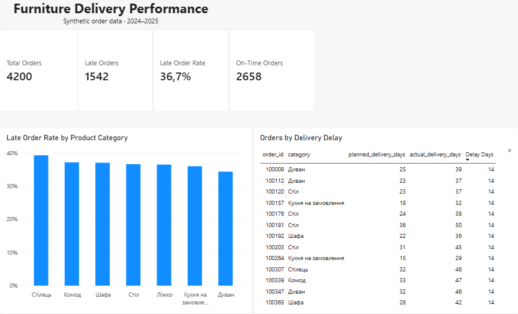

# Furniture Sales Analysis & Delivery Risk Prediction

End-to-end data science project analyzing sales performance of a custom
furniture manufacturer (Poland, 2024–2025) and building machine learning
models to predict order revenue and delivery delay risk.

> Built as a portfolio project by a Python/Data Science learner with
> real-world experience in the custom furniture industry.

## Power BI — Furniture Delivery Performance

The report compares planned and actual delivery lead times for 4,200 synthetic furniture orders from 2024–2025. Use the category chart to compare late delivery rates and the order-level table to inspect the longest delays.



| Metric | Result |
| --- | ---: |
| Delivered on time or early | 2,658 (63.3%) |
| Delivered late | 1,542 (36.7%) |
| Category with the highest late delivery rate | Chairs, 39.3% (242 of 616) |
| Longest delivery delay | 14 days |

A delivery is late when actual delivery days exceed planned delivery days. The report uses DAX measures to calculate order counts and the late delivery rate.

[Download the Power BI report (.pbix)](reports/furniture-delivery-performance.pbix?raw=true) and open it in Power BI Desktop. To refresh the CSV source on a different computer, point the query to [data/furniture_sales.csv](data/furniture_sales.csv) in your local copy of the repository.

## Project Overview

This project simulates a realistic dataset for a furniture manufacturing
company (based on domain knowledge of the industry) and walks through a
complete data science workflow:

1. **Synthetic data generation** — 4,200 orders over 2 years, with
   realistic seasonality, pricing logic, and delivery-risk patterns
2. **Exploratory Data Analysis (EDA)** — revenue trends, regional and
   category breakdowns, correlation analysis
3. **Machine Learning — Regression** — predicting order revenue
4. **Machine Learning — Classification** — predicting delivery delay
   risk (the business-critical use case)

## Key Business Insights (from EDA)

- Clear seasonality: demand peaks in **spring (Mar–Apr)** and
  **autumn (Sep–Oct)**, with a summer slowdown — typical of the
  home-renovation cycle
- **Custom-made orders** are delayed significantly more often than
  standard-catalog orders
- Delivery delays have a **strong negative impact on customer
  satisfaction** (correlation ≈ -0.6)
- Premium materials (oak, ash) and large wholesale orders carry
  higher delay risk

## Machine Learning Results

### 1. Revenue Prediction (Regression)

| Model | MAE | RMSE | R² |
|---|---|---|---|
| Linear Regression | ~1447 PLN | ~3104 PLN | 0.68 |
| **Random Forest** | **~122 PLN** | **~473 PLN** | **0.99** |

Revenue is largely a deterministic function of price, quantity, and
discount, so the near-perfect R² is expected — this task mainly
demonstrates feature engineering and pipeline construction
(one-hot encoding + ColumnTransformer).

### 2. Delivery Delay Risk (Classification) — the real value-add

This is the more interesting problem: **can we flag high-risk orders
at the moment they're placed**, before production even starts?
Only information known upfront is used (no data leakage from actual
delivery time).

| Model | ROC-AUC | Recall (Delayed) | Precision (Delayed) |
|---|---|---|---|
| **Logistic Regression** | **0.74** | 0.66 | 0.56 |
| Random Forest | 0.73 | 0.65 | 0.56 |

With class balancing, the model catches ~2 out of 3 orders that will
actually be delayed — actionable enough to trigger proactive customer
communication or production prioritization.

## Visualizations

All charts are in [`/visuals`](./visuals):

| File | Description |
|---|---|
| `01_monthly_revenue.png` | Revenue trend & seasonality |
| `02_revenue_by_category.png` | Revenue by product category |
| `03_orders_by_region.png` | Order volume by region |
| `04_delay_by_custom.png` | Delay rate: custom vs standard orders |
| `05_correlation_heatmap.png` | Correlation matrix |
| `06_satisfaction_vs_delay.png` | Satisfaction impact of delays |
| `07_revenue_actual_vs_predicted.png` | Regression fit quality |
| `08_feature_importance_revenue.png` | Top revenue drivers |
| `09_roc_curve_delay.png` | ROC curve, delay classifier |
| `10_confusion_matrix_delay.png` | Confusion matrix, delay classifier |
| `11_feature_importance_delay.png` | Top delay-risk drivers |

## Project Structure

```
furniture-sales-analysis/
├── data/
│   └── furniture_sales.csv        # generated dataset (4,200 orders)
├── notebooks/
│   └── furniture_sales_analysis.ipynb  # full walkthrough, ready to view on GitHub
├── src/
│   ├── generate_data.py           # synthetic data generation
│   ├── eda.py                     # exploratory analysis + charts
│   ├── model_revenue.py           # regression pipeline
│   └── model_delay.py             # classification pipeline
├── visuals/                       # all generated charts (.png)
├── requirements.txt
└── README.md
```

> **Quick look:** the fastest way to see the whole project is to open
> [`notebooks/furniture_sales_analysis.ipynb`](./notebooks/furniture_sales_analysis.ipynb)
> directly on GitHub — it's pre-run, so all charts and results render
> without installing anything.

## Tech Stack

`Python` · `pandas` · `numpy` · `scikit-learn` · `matplotlib` · `seaborn`

## How to Run

```bash
pip install -r requirements.txt
python src/generate_data.py    # generates data/furniture_sales.csv
python src/eda.py              # generates EDA charts
python src/model_revenue.py    # trains & evaluates regression models
python src/model_delay.py      # trains & evaluates classification models
```

## Notes on the Data

The dataset is **synthetically generated** (see `src/generate_data.py`)
rather than scraped or leaked from a real company, but the generation
logic is grounded in real domain knowledge of the custom furniture
business: pricing by material and category, production/delivery lead
times, and the drivers of delay risk. This was a deliberate choice to
keep the project fully shareable while staying business-realistic.

## Possible Next Steps

- Time-series forecasting (e.g. Prophet/ARIMA) for monthly demand
- Hyperparameter tuning (GridSearchCV) for both models
- Deploy the delay-risk model as a simple API (FastAPI) or Streamlit
  demo app
